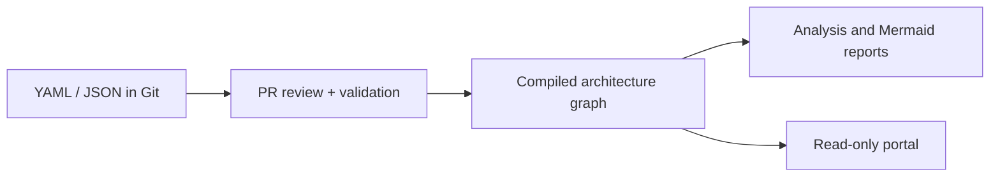

<p align="center">
  
</p>

# Tecton 🏛️

**Enterprise architecture as code. Maintain a catalog in Git, validate changes, and explore the model through a generated portal.**


[](LICENSE)
[](https://github.com/senssei/tecton/actions/workflows/ci.yml)


Tecton is a Python CLI and library for reviewing enterprise architecture models.
It reads YAML/JSON manifests, compiles an in-memory graph, checks consistency,
and produces portfolio reports, Mermaid diagrams and a read-only web portal.

> **Package:** `tecton-arch` · **Python import:** `tecton_arch` · **CLI:** `tecton`
>
> This project is independent of the unrelated `tecton` package on PyPI.
> The first `tecton-arch` release is being prepared; install from this checkout until it is published.

## ✨ What it does

| Capability | Available behavior |
| --- | --- |
| 📚 Catalog | Systems, child components, capabilities, technologies, interfaces, data objects and roadmaps |
| ✅ Validation | Duplicate IDs, broken references, capability cycles, lifecycle and roadmap checks; optional required system owner |
| 📊 Portfolio | Threshold-based TIME classification and pairwise functional overlap detection |
| 🧭 Architecture analysis | Capability coverage, technology blast radius, declared data lineage and plateau comparisons |
| 🔎 Review | Semantic directory/Git diff and reports suitable for PR review |
| 🌐 Publishing | Mermaid, Markdown and HTML portal exports; Backstage and ArchiMate connectors |

## 🚀 Quick start

Requires Python 3.11+. From a checkout of this repository:

```bash
python -m venv .venv
source .venv/bin/activate
python -m pip install -e '.[dev]'
tecton --version
tecton validate examples/dogfood/tecton_c4_workspace --require-owner
tecton apm analyze --source examples/dogfood/tecton_c4_workspace
tecton export portal --source examples/dogfood/tecton_c4_workspace -o dist/portal
```

Open `dist/portal/index.html`, or serve the model locally:

```bash
tecton portal --source examples/dogfood/tecton_c4_workspace
```

The portal is at `http://127.0.0.1:8000/`; API documentation is at
`http://127.0.0.1:8000/docs`. On Windows, activate the environment with
`.venv\Scripts\Activate.ps1` in PowerShell.

## 🗂️ Git EAM pilot

The [pilot catalog](examples/dogfood/tecton_c4_workspace) models one Tecton
product with 15 logical child components. Architects and tech leads edit YAML;
reviewed PRs maintain the catalog. CI validates the merged model and exports a
portal artifact. The [pilot guide](docs/08_git_eam_pilot.md) describes ownership,
acceptance exercises and branch protection.



## 📖 Documentation

- [Getting started](docs/getting_started.md) — installation and your first model.
- [CLI reference](docs/cli_reference.md) — commands, sources and exit codes.
- [Manifest reference](docs/manifest_reference.md) — entity fields and graph rules.
- [Architecture and design index](docs/README.md) — implementation, risks and ADRs.
- [Contributing](CONTRIBUTING.md) — development and verification.
- [GitHub setup](docs/github_publication.md) and [PyPI releases](docs/pypi_release.md).

## ⚠️ Current limits

This is an alpha tool. Analysis reflects the supplied metadata; it does not
inspect deployed systems, scan vulnerabilities or certify regulatory compliance.
Dependency cycles are warnings unless `validate --strict` is used. The default
pilot gate allows warnings.

Local analysis needs no remote EAM account. The HTML export embeds its data but
loads Tailwind and Mermaid from CDNs, so full styling and diagrams require network
access. Repository patches default to simulation; import/export commands write
output files. See the [CLI reference](docs/cli_reference.md) for persistence limits.

## ⚖️ License

[Apache License 2.0](LICENSE). Copyright 2026 Tecton contributors.
