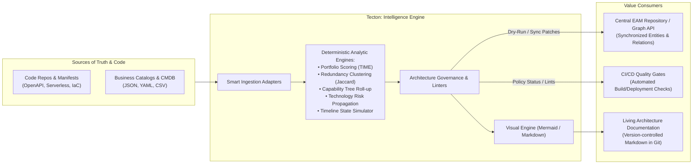
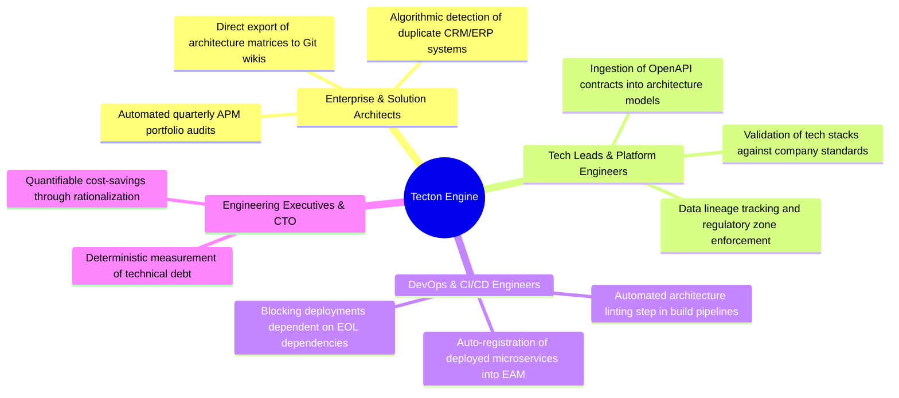

# Product Vision: Tecton (Enterprise Architecture Intelligence Engine)

> **Mission:** Liberate enterprise architecture analytics from proprietary web portal constraints by introducing a programmable, deterministic **Architecture-as-Code** platform with automated CI/CD quality gates.

---

## 1. Problem Statement: The SaaS EAM Repository Paradox

Modern Enterprise Architecture Management (**EAM**) platforms serve as valuable centralized repositories of IT landscape metadata. They provide graph-based metamodels and visual web interfaces for enterprise architects. However, from the perspective of modern software engineering and automation, these systems exhibit a fundamental disconnect:

```
┌────────────────────────────────────────────────────────────────────────┐
│                     THE CLOSED EAM REPOSITORY PARADOX                  │
├──────────────────────────────────┬─────────────────────────────────────┤
│ What the Web UI displays:        │ What the programmatic API provides: │
│ • Intelligent TIME scoring       │ • Passive storage of entities/fields│
│ • Graphical redundancy matrices  │ • Zero embedded analytical engines  │
│ • Cascading technology risks     │ • No risk propagation calculations  │
│ • Capability trees with roll-up  │ • Flat lists without aggregation    │
│ • Rich diagrams and roadmaps     │ • Zero diagram export endpoints     │
└──────────────────────────────────┴─────────────────────────────────────┘
```

### Core Organizational Pain Points:
1. **Analytics Trapped in the Browser:** Strategic insights require manual architect interaction in web portals. Analytical evaluations cannot be integrated into CI/CD pipelines, batch jobs, or automated reporting scripts.
2. **Lack of Architecture-as-Code:** While infrastructure (IaC), configuration (CaC), and deployment pipelines (GitOps) are fully versioned in Git repositories, enterprise architecture models remain manually maintained artifacts in proprietary SaaS databases.
3. **Absence of Architecture Quality Gates:** Code reaches production environments coupled with obsolete (End-of-Life) or prohibited technologies because CI/CD systems lack a fast, deterministic engine for **Architecture Linting**.
4. **SaaS Automation Execution Constraints:** Embedded automation scripts in cloud EAM platforms face stringent runtime limits (typically 5 seconds execution and 256 MB RAM), making complex graph analytics across thousands of components unfeasible.

---

## 2. What is Tecton? (Product Definition)

**Tecton** is an open, modular **Enterprise Architecture Intelligence Engine** that serves as an offline-first computational layer and integration bridge between source code repositories, CI/CD pipelines, and centralized EAM repositories.

Tecton **does not replace** the central EAM repository as the system of record — **it empowers it with a deterministic computational brain, an analytical engine, and an automated CLI toolchain**.



---

## 3. Product Pillars

### Pillar I: Active Architecture Intelligence (Deterministic Analytics)
Replacing opaque web portal calculations with explicit, deterministic algorithms:
*   **TIME Classifier:** Algorithmic assignment of applications into *Tolerate*, *Invest*, *Migrate*, and *Eliminate* quadrants based on configurable business and technical suitability thresholds.
*   **Redundancy Clusterer:** Mathematical detection of overlapping software systems serving duplicate business capabilities and user groups using weighted Jaccard similarity metrics.
*   **Capability Roll-up Engine:** Recursive aggregation of metrics (costs, maturity, risk) up the hierarchical capability tree (L3 ➔ L2 ➔ L1) using post-order graph traversal.
*   **Risk Cascade Simulator:** Dynamic propagation of obsolete technology risks (EOL/EOS) downstream across dependency graphs to affected business applications.

### Pillar II: Architecture-as-Code & GitOps
Treating enterprise architecture as a version-controlled, testable engineering asset:
*   Declarative specification of mapping rules, evaluation thresholds, and technology governance standards in versioned YAML/JSON files.
*   Unit-testable architectural governance rules within standard testing frameworks.
*   Architecture modifications driven through Pull Requests, code reviews, and automated verification.

### Pillar III: Architecture Quality Gates in CI/CD
A lightweight, fast CLI executable designed for containerized deployment pipelines:
*   Pre-deployment linting verifying whether newly introduced services adhere to the organization's approved technology stacks (*Approved Technology Governance*).
*   Automated build breaks when services depend on prohibited, deprecated, or vulnerable components.

### Pillar IV: Sovereign Visualizations (Living Docs)
Native rendering of visual documentation without web portal dependencies:
*   Native export of standard **Mermaid** diagrams (`quadrantChart`, `flowchart`, `graph TD`).
*   Automated generation of **Markdown** and **HTML** living documentation artifacts, easily versioned in Git and published to engineering portals.

### Pillar V: Zero-Trust & Safety-First Synchronization
*   Mandatory default **`--dry-run`** execution for all repository-mutating commands.
*   Precise calculation and display of JSON Patch deltas before any remote write operations occur.
*   Full offline capability operating on local snapshots, in-memory fixtures, and test mocks.

---

## 4. Target Personas & Use Cases



---

## 5. Value Matrix: Traditional EAM vs. Tecton

| Dimension | Traditional SaaS EAM Process | Tecton (Architecture-as-Code) |
| :--- | :--- | :--- |
| **Portfolio Evaluation** | Manual clicking and subjective reviews in web portals | Instant CLI evaluation: `tecton apm analyze` in milliseconds |
| **Redundancy Discovery** | Subjective, error-prone human inspection | Deterministic Jaccard similarity clustering |
| **CI/CD Integration** | Infeasible due to web constraints and API limitations | Native pipeline quality gate: `tecton policy check` |
| **Visual Architecture** | Locked inside proprietary SaaS dashboards | Native Mermaid diagrams and living Markdown in Git |
| **Write Safety** | High risk of unintended remote data overwrites | Mandatory `--dry-run` with explicit JSON Patch previews |
