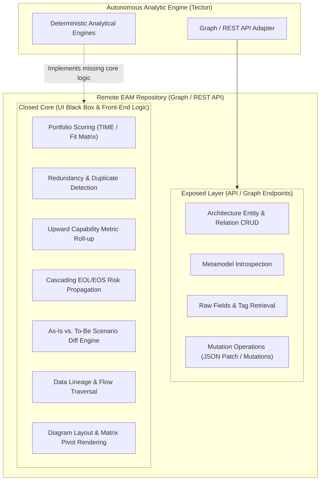

# Adversarial Analysis: EAM Repository APIs vs. Domain Logic (Domains 1–6)

This document provides a comprehensive functional assessment and critical gap analysis (*adversarial analysis*) of six foundational domains in **Enterprise Architecture Management (EAM)**. It contrasts what remote repository APIs (such as GraphQL and REST Graph APIs) expose against what an autonomous architecture intelligence engine must implement independently.

---

---

## 1. Application Portfolio Management (APM)

### A. Domain Requirements
*   **Architectural Entities:** `Application` entity.
*   **Key Processes:**
    *   Centralized software inventory, ownership tracking, and operational attributes.
    *   Portfolio classification using Gartner's **TIME** model (*Tolerate*, *Invest*, *Migrate*, *Eliminate*).
    *   Multidimensional suitability evaluation: *Business Fit* (functional alignment, criticality) and *Technical Fit* (maintainability, architectural quality, technical debt).
    *   Lifecycle stage progression: *Plan* ➔ *Phase-in* ➔ *Active* ➔ *Phase-out* ➔ *End-of-life*.

### B. What the Repository API Exposes
*   Read and write access to raw application attributes via graph queries (GraphQL / REST).
*   Retrieval of defined lifecycle phases and associated metadata tags.
*   Selective field modification using JSON Patch operations (`add`, `replace`, `remove`).

### C. The Adversarial Gap (Missing in API)
1. **No Dynamic TIME Scoring Engine:** The API returns only static, pre-recorded strings. There is no endpoint that evaluates and returns real-time TIME recommendations when suitability metrics change.
2. **No Redundancy Detection Algorithm:** The API provides zero endpoints for functional overlap analysis. Discovering that two systems serve duplicate business functions requires external clients to pull the entire inventory and perform set intersections.
3. **No Chronological Lifecycle Guardrails:** Repository APIs accept mutations with contradictory dates (e.g., phase-out dates preceding active dates), delegating all consistency enforcement to external clients.

### D. Tecton Engine Implementation
*   A standalone `TimeScoringEngine` executing deterministic quadrant classification based on configurable business and technical thresholds.
*   A mathematical `RedundancyDetectionEngine` implementing weighted Jaccard similarity across capability sets and organizational user groups.

---

## 2. Business Capability Management (BCM)

### A. Domain Requirements
*   **Architectural Entities:** `BusinessCapability` entity, realization relation (`App-to-Capability`).
*   **Key Processes:**
    *   Multilevel hierarchical decomposition (L1 ➔ L2 ➔ L3).
    *   Mapping software systems to capabilities (distinguishing leading vs. supporting systems).
    *   Coverage assessment, maturity evaluation, and gap analysis.

### B. What the Repository API Exposes
*   Retrieval of flat entity lists with basic parent-child relations.
*   CRUD operations on application-to-capability relationships.

### C. The Adversarial Gap (Missing in API)
1. **No Recursive Subtree Operations:** Standard graph queries require retrieving all nodes and reconstructing the hierarchical tree in client memory.
2. **No Upward Metric Roll-up Engine:** Aggregate metrics (such as total application cost, technical debt, or combined risk) displayed at level L1 in web portals are calculated purely in-browser. The API node at L1 **does not** return aggregated descendant values.
3. **No Algorithmic Gap Analysis:** The API provides no endpoint returning unserved or over-served capabilities.

### D. Tecton Engine Implementation
*   A hierarchical `CapabilityTree` structure with *post-order traversal* algorithms computing recursive metric roll-ups.
*   A deterministic `GapDetector` identifying capabilities lacking adequate architectural realization.

---

## 3. Technology Risk & Obsolescence Management (TRM)

### A. Domain Requirements
*   **Architectural Entities:** `TechnologyComponent`, `Provider`, `TechnologyStack`.
*   **Key Processes:**
    *   Tracking manufacturer end-of-support dates (*End-of-Life / End-of-Support*).
    *   Governance classification: *Approved*, *Under Evaluation*, *Phasing Out*, *Prohibited*.
    *   Cascading underlying infrastructure risks to business applications.

### B. What the Repository API Exposes
*   Read access to technology components, version metadata, providers, and lifecycle dates.
*   Creation and deletion of application-to-component dependencies.

### C. The Adversarial Gap (Missing in API)
1. **Reference Catalog Matching is a Closed Black Box:** Automated catalog enrichment operates asynchronously as vendor background processes — no synchronous API endpoint exists to query component lifecycles on demand.
2. **No Risk Propagation Engine:** When an underlying database reaches EOL, the API does not compute or return an `effectiveTechnologyRisk` score on dependent application entities. Risk propagation must be computed externally.
3. **No Architectural Guardrails on Mutation:** The API accepts mutations linking mission-critical applications to prohibited or obsolete technologies without validation errors.

### D. Tecton Engine Implementation
*   An architectural `PolicyEngine` enforcing technology standards prior to mutation execution.
*   A graph traversal algorithm (BFS/DFS) calculating downstream risk cascade indices across application dependencies.

---

## 4. Architecture and Roadmap Planning

### A. Domain Requirements
*   **Architectural Entities:** `Initiative / Project`, `TransformationItem`.
*   **Key Processes:**
    *   Baseline (*As-Is*) and target (*To-Be*) state modeling.
    *   Aligning project schedules with application lifecycle milestones.
    *   Architectural impact and conflict analysis.

### B. What the Repository API Exposes
*   CRUD access to project entities, scheduled dates, and links to impacted applications.

### C. The Adversarial Gap (Missing in API)
1. **No As-Is vs. To-Be Diff Engine:** The API offers no endpoint computing structural deltas between transformation scenarios and current baselines.
2. **No Temporal State Simulation:** Clients cannot query the graph state at an arbitrary point in time $T$ in a single request.
3. **No Project Collision Detection:** Parallel initiatives modifying identical interfaces or applications are not flagged for scheduling conflicts via the API.

### D. Tecton Engine Implementation
*   A `TimelineSimulator` reconstructing the architectural graph state for any given timestamp.
*   A scenario delta calculator identifying collisions and structural transformations.

---

## 5. Data & Interface Management

### A. Domain Requirements
*   **Architectural Entities:** `Interface / Contract`, `DataObject`.
*   **Key Processes:**
    *   Integration point inventory (REST, GraphQL, gRPC, event streaming, batch).
    *   End-to-end data lineage tracking across service chains.
    *   Data confidentiality classification and regulatory compliance (e.g., GDPR).

### B. What the Repository API Exposes
*   Declarative entities for interfaces and data objects, including provider/consumer links.

### C. The Adversarial Gap (Missing in API)
1. **No Technical Contract Parsers:** Repository APIs store passive metadata and cannot parse OpenAPI, AsyncAPI, or Protobuf specifications.
2. **No Automated Data Lineage Engine:** Tracing full data flows through multi-hop chains ($A \to B \to C \to D$) requires external graph traversal algorithms.
3. **No Confidentiality Zone Governance:** The API does not detect or prevent leaks where restricted data is transmitted to systems with lower security classifications.

### D. Tecton Engine Implementation
*   Contract ingestion adapters parsing technical OpenAPI/Swagger files into architectural interface entities.
*   A `LineageGraphBuilder` reconstructing end-to-end data flows with confidentiality boundary validation.

---

## 6. Reporting, Visualizations & Presentation

### A. Domain Requirements
*   **Visual Formats:** Matrix reports, Landscape capability grids, Quadrant portfolio charts, flow diagrams.
*   **Key Processes:**
    *   Synthesizing architectural state for executive stakeholders.
    *   Publishing documentation to developer portals and code repositories.

### B. What the Repository API Exposes
*   Access to raw JSON graph data feeding visual views.
*   Retrieval of saved filter bookmark metadata.

### C. The Adversarial Gap (Missing in API)
1. **Zero Diagram Export Endpoints:** Public repository APIs **do not render or return visual diagrams** (PNG, SVG, or PDF). All rendering is executed client-side in the browser.
2. **No Layout or Geometry Data in API:** Spatial coordinates, container boundaries, and connector paths are completely inaccessible programmatically.
3. **No Matrix Calculation Engine:** Constructing matrix pivot tables outside the web interface requires client applications to compute cell intersections from scratch.

### D. Tecton Engine Implementation
*   Native, sovereign visual generators targeting open standards:
    *   **Mermaid** diagram generators (`quadrantChart`, `graph TD`, `flowchart`).
    *   **Markdown** living documentation generators integrated into GitOps workflows.

---

## Responsibility Matrix Summary

| Architectural Domain | Remote EAM Repository Responsibility | Tecton Engine Responsibility |
| :--- | :--- | :--- |
| **1. Application Portfolio (APM)** | Metadata & attribute storage | Deterministic TIME scoring, Jaccard redundancy clustering |
| **2. Business Capabilities (BCM)** | Node and relation storage | Tree hierarchy construction, metric roll-up, gap analysis |
| **3. Technology Risk (TRM)** | Infrastructure component catalog | Policy linting gates, cascading risk propagation |
| **4. Roadmap Planning** | Initiative storage & schedules | Point-in-time ($T$) simulation, As-Is vs. To-Be diffs |
| **5. Data & Interfaces** | Declarative interface registration | OpenAPI contract parsing, multi-hop lineage tracing |
| **6. Visualizations & Reports** | Closed browser UI rendering | Sovereign Mermaid diagrams, Markdown living docs, CI/CD integration |
