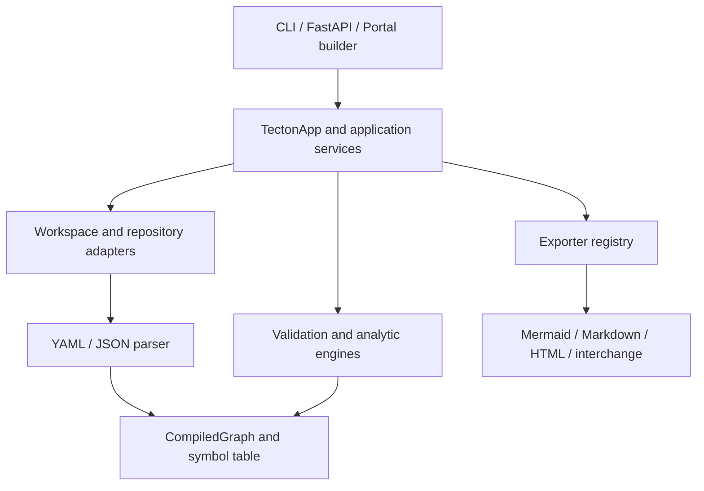

# 🧱 Implemented architecture

Tecton is a Python modular monolith. Local architecture manifests are compiled
into an in-memory graph; services evaluate that graph and delivery channels
present results. The source namespace is `tecton_arch`.

## Layers and data flow

| Package | Responsibility |
| --- | --- |
| `core` | Application, lifecycle, scoring/configuration models |
| `dsl` | EAM manifest schemas, parsing, symbol table and graph indexes |
| `engines` | Validation, TIME, overlap, capabilities, technology, lineage, roadmap and diff |
| `adapters` | In-memory, legacy file, Git workspace and GraphQL I/O |
| `services` | Domain-specific orchestration, including APM and Git revision diff |
| `application` | `TectonApp`, workspace abstraction, DTOs and exporters |
| `cli`, `server`, `portal` | Argument/HTTP translation, display and HTML generation |
| `connectors`, `exporters` | Supported interchange mappings and textual reports |

The AST fitness test prohibits direct imports of engines, connectors and the
DSL parser in delivery packages, and engine imports in the DSL package. CLI
commands can still delegate to domain services; this is not total facade-only
or dependency-inversion enforcement. `CompiledGraph` remains a concrete shared type.

## Algorithms and configuration

TIME classifies functional/technical suitability on the 1–5 scale with default
thresholds of 3.5. This implementation's mapping is:

| Functional fit | Technical fit | Result |
| --- | --- | --- |
| High | High | `INVEST` |
| High | Low | `TOLERATE` |
| Low | High | `MIGRATE` |
| Low | Low | `ELIMINATE` |
| Either missing | Any | `UNKNOWN` |

These project-specific labels follow the existing code and tests; review them
against your portfolio methodology before using the recommendations.

Overlap compares application pairs using weighted Jaccard scores, defaulting
to 0.7 for capabilities and 0.3 for user groups, with a 0.7 finding threshold.
If only one dimension has data, its unweighted score is used; if neither has
data, similarity is zero. Findings are pairs, not transitive merged clusters.
Pairwise comparison is quadratic in the number of applications.

BCM evaluates direct system-to-capability mappings and stored TIME classifications.
It does not calculate cost/maturity roll-ups over descendants. Graph adjacency
indexes provide direct lookup of incoming/outgoing edge lists; a traversal still
costs time proportional to visited nodes and edges.

## State and time

`Workspace` accepts a path, a compiled graph, or an application repository.
Graph-based use cases require a graph-capable source. Git TIME persistence writes
a temporary file, replaces one source file, then reloads the graph. It does not
provide atomic multi-file mutations or a general JSON Patch implementation.

Lifecycle validation, the graph linter, and TRM expose selected `as_of_date`
parameters. Lifecycle inference, roadmap analysis/rendering and semantic diff
still have current-date dependencies. There is no global fixed-date CLI option;
results involving dates may change between runs.

## Verification

Unit tests cover analytical rules, schemas, graph checks, adapters and connectors.
Integration tests cover CLI commands, API endpoints, the pilot workflow and
application facade. CI also checks documentation examples and distribution builds.
Performance targets in the [quality attribute notes](05_attribute_driven_design.md)
are design goals, not published benchmarks.
