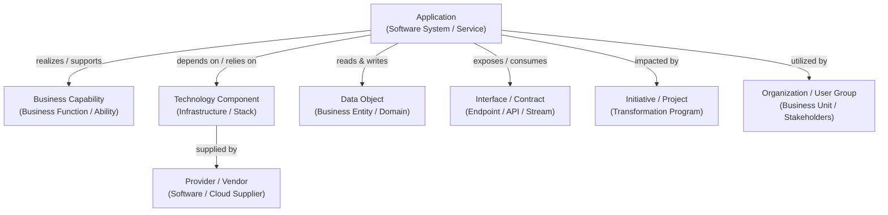

# Standard EAM Capability Catalog & Metamodel Specification

This document provides a generic, industry-standard taxonomy of Enterprise Architecture Management (**EAM**) modules, architectural entity types, and graph relationships based on open frameworks (TOGAF, ArchiMate, BIAN) and modern graph repositories.

---

## 1. Architectural Metamodel & Graph Structure

The structural foundation of an EAM repository is a directed **Metamodel Graph**, where nodes represent **Architecture Entities / Artifacts** and edges represent **Architectural Relations**.

### Standard Entity Types
| Entity Type | Architectural Role | Generic Node Representation |
| :--- | :--- | :--- |
| **`Application`** | Deployed software systems and business application services. | `Application` Artifact / Node |
| **`BusinessCapability`** | What an organization does, decoupled from implementation technology. | `BusinessCapability` Artifact / Node |
| **`TechnologyComponent`** | Infrastructure building blocks, runtimes, frameworks, and databases. | `TechnologyComponent` Artifact / Node |
| **`Interface`** | Communication contracts, API endpoints, message queues, and batch transfers. | `Interface` Artifact / Node |
| **`DataObject`** | Business information entities (e.g., Customer, Invoice) with privacy tiers. | `DataObject` Artifact / Node |
| **`Initiative` / `Project`** | Strategic transformation programs, migrations, and release initiatives. | `Project` Artifact / Node |
| **`UserGroup` / `OrgUnit`** | Organizational divisions, departments, or external user segments. | `UserGroup` Artifact / Node |
| **`Provider`** | External technology vendors, cloud providers, and SaaS suppliers. | `Provider` Artifact / Node |
| **`TechnologyStack`** | Categorization of architectural tiers (Frontend, Backend, Database). | `TechnologyStack` Category |

---

## 2. Standard Functional Modules in Enterprise Architecture

### Module I: Application Portfolio Management (APM)
*   **Centralized Inventory:** Single source of truth for software systems, ownership, hosting, and operational status.
*   **Lifecycle Management:** Standardized phase tracking (*Plan*, *Phase-in*, *Active*, *Phase-out*, *End-of-life*).
*   **Gartner TIME Framework:** Objective categorization into *Tolerate*, *Invest*, *Migrate*, and *Eliminate*.
*   **Multidimensional Fit Assessment:** Business Fit (alignment, criticality) and Technical Fit (quality, debt).
*   **Portfolio Rationalization:** Identification of redundant, duplicative, or underutilized software assets.

---

### Module II: Business Capability Management (BCM)
*   **Hierarchical Capability Trees:** Structured functional decomposition (L1 ➔ L2 ➔ L3).
*   **Capability Realization Mapping:** Linking applications to supported capabilities with role designations.
*   **Heatmaps & Maturity Modeling:** Color-coded visualization of coverage, cost distribution, and maturity.
*   **Architectural Gap Analysis:** Uncovering business capabilities lacking technical realization.
*   **Industry Reference Catalogs:** Standardized capability baselines (e.g., BIAN, eTOM).

---

### Module III: Technology Risk & Obsolescence Management (TRM)
*   **Infrastructure Component Catalog:** Tracking software packages, runtime versions, databases, and OS platforms.
*   **Obsolescence Tracking:** Monitoring vendor End-of-Life (EOL) and End-of-Support (EOS) milestones.
*   **Technology Standards Governance:** Classifying technologies as *Approved*, *Under Evaluation*, or *Prohibited*.
*   **Risk Cascade Modeling:** Identifying vulnerability propagation from obsolete infrastructure to critical business applications.

---

### Module IV: Architecture Roadmap & Target State Planning
*   **State Modeling:** Defining current (*As-Is*) versus desired future (*To-Be*) architectural baselines.
*   **Milestone & Schedule Alignment:** Coordinating transformation initiatives with application phase transitions.
*   **Architectural Impact Analysis:** Analyzing cascading dependency impacts when decommissioning systems.

---

### Module V: Data & Interface Architecture
*   **Interface Catalog:** Recording API protocols (REST, GraphQL, gRPC), event brokers, and schemas.
*   **Data Object Modeling:** Cataloging key domain entities with regulatory and privacy classifications (e.g., GDPR).
*   **End-to-End Data Lineage:** Mapping data flow trajectories across enterprise application boundaries.

---

### Module VI: Visualizations, Reporting & Presentation
*   **Landscape Reports:** Two-dimensional grid views mapping capabilities against organizations and applications.
*   **Matrix Reports:** Pivot matrices displaying intersections across arbitrary entity pairs.
*   **Portfolio Quadrant Charts:** 2D scatter plots evaluating business fit versus technical fit.
*   **Roadmap Gantt Views:** Timeline visualizations of lifecycle milestones and project schedules.
*   **Architectural Diagrams:** Live diagrams reflecting real-time repository state.

---

### Module VII: Governance, Crowdsourcing & Quality Assurance
*   **Stakeholder Surveys:** Automated distributed data collection from application owners.
*   **Quality Seals & Completeness Metrics:** Formal certification of entity completeness and timeliness.
*   **RACI Responsibility Subscriptions:** Explicit role assignments (*Responsible*, *Accountable*, *Consulted*, *Informed*).

---

### Module VIII: AI-Assisted Architecture
*   Natural language semantic querying over enterprise graph inventories.
*   Automated summarization and rationalization recommendations.
*   Enrichment of missing entity metadata and automated categorization.

---

### Module IX: Integration Protocols & Graph APIs
*   **Graph / REST APIs:** Traversal of entities, relationship edges, and delta mutation patches.
*   **Event Subscriptions (Webhooks):** Real-time notifications upon entity state transitions.
*   **Ecosystem Connectors:** Integrations with CMDBs (ServiceNow), issue trackers (Jira), and business process tools.
