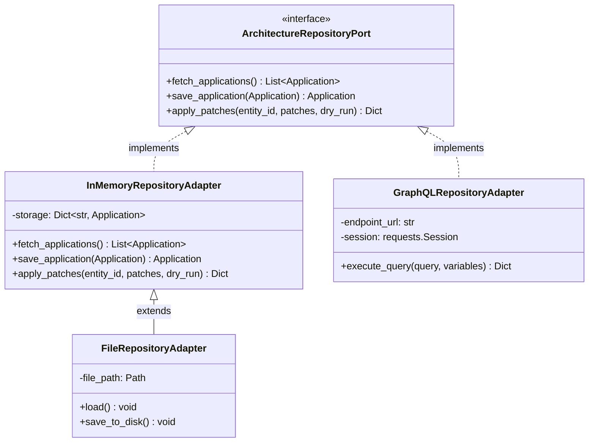

# Attribute-Driven Design (ADD 3.0) Specification for Tecton

This document formalizes the architectural design of **Tecton** using the Software Engineering Institute (**SEI**) **Attribute-Driven Design (ADD 3.0)** methodology (Bass, Clements, Kazman).

---

## 1. Architectural Drivers (Inputs to ADD)

### A. Design Purpose
Design an open, deterministic, offline-first Enterprise Architecture Intelligence Engine capable of evaluating application portfolios, enforcing architecture quality gates in CI/CD, and generating living documentation without vendor lock-in.

### B. Functional Requirements (FRs)
*   **FR-1 (APM Portfolio Evaluation):** Ingest application metadata and deterministically evaluate Gartner TIME quadrants.
*   **FR-2 (Redundancy Detection):** Quantify functional and organizational overlap across software systems using mathematical set metrics.
*   **FR-3 (Lifecycle Consistency):** Detect chronological anomalies and expired components across entity lifecycles.
*   **FR-4 (Living Documentation):** Render standard visual artifacts (Mermaid quadrant charts, Markdown living docs).
*   **FR-5 (Repository Synchronization):** Generate precise delta patches (JSON Patch) and synchronize with remote EAM graph APIs.

### C. Quality Attribute Requirements (QARs & Utility Tree)

| Quality Attribute | Priority | Attribute Refinement / Quality Attribute Scenario |
| :--- | :--- | :--- |
| **QA-1: Testability** | **(High, High)** | **Offline Unit & Integration Testing:** 100% of analytic engine and service tests must execute without network connectivity or external SaaS credentials in under 2 seconds. |
| **QA-2: Modifiability** | **(High, High)** | **Repository Decoupling:** Integrating a new storage backend (e.g., Ardoq, Git-based YAML, Neo4j) must only require implementing `ArchitectureRepositoryPort` without modifying any domain model or engine. |
| **QA-3: Safety & Integrity** | **(High, High)** | **Zero-Risk Mutation:** Under all circumstances, executing mutation commands without the explicit `--apply` flag must perform a non-destructive simulation (`--dry-run`), returning planned JSON Patches with zero remote state modification. |
| **QA-4: Performance** | **(High, Medium)** | **Sub-Second Local Analytics:** Evaluating TIME classification and computing $O(N^2)$ Jaccard redundancy clustering across 1,000 applications must execute in under 500 ms in a standard CI container. |
| **QA-5: Interoperability** | **(Medium, High)** | **Zero Vendor Lock-in Visualizations:** All generated diagrams must use open, native Mermaid syntax rendered directly in version-controlled Markdown without proprietary image rendering APIs. |

### D. Architectural Constraints (CONs)
*   **CON-1:** Implementation must be pure Python `>=3.11` using modern type annotations (`typing.Protocol`, Pydantic v2).
*   **CON-2:** CLI must follow standard POSIX conventions, returning non-zero exit codes upon failure and providing human-readable terminal output.

---

## 2. Iteration 1: Establishing the System Decomposition & Core Architecture

### Step 1: Element Selection
*   **Element:** Entire Tecton System.
*   **Drivers Addressed:** QA-1 (Testability), QA-2 (Modifiability), QA-3 (Safety), QA-5 (Interoperability).

### Step 2: Selection of Architectural Tactics & Patterns
To satisfy the prioritized quality attributes, the following SEI architectural tactics were selected:

```
┌────────────────────────────────────────────────────────────────────────┐
│                        ARCHITECTURAL TACTICS                           │
├────────────────────┬───────────────────────────────────────────────────┤
│ Modifiability      │ • Tactic: Reduce Coupling (Hexagonal Architecture)│
│                    │ • Tactic: Encapsulate Variation (Strategy Pattern)│
│                    │ • Tactic: Abstract Common Services (Port Interfaces)│
├────────────────────┼───────────────────────────────────────────────────┤
│ Testability        │ • Tactic: Dependency Inversion (In-Memory Doubles)│
│                    │ • Tactic: Deterministic Engines (Pure Functions)  │
├────────────────────┼───────────────────────────────────────────────────┤
│ Safety & Security  │ • Tactic: Fail-Safe Defaults (Default Dry-Run)   │
│                    │ • Tactic: Audit Trail (Explicit JSON Patch Diffs) │
├────────────────────┼───────────────────────────────────────────────────┤
│ Performance        │ • Tactic: Resource Arbitration (Batch Processing) │
│                    │ • Tactic: Vectorized / Set-Based Math (Jaccard)   │
└────────────────────┴───────────────────────────────────────────────────┘
```

1. **Hexagonal Architecture (Ports and Adapters):**
   * Separates the **Domain Layer** (pure domain entities and deterministic engines) from the **Infrastructure Layer** (Graph API adapters, file systems, CLI).
   * Directly satisfies **QA-2 (Modifiability)** and **QA-1 (Testability)**.
2. **Strategy Pattern for Analytic Engines:**
   * Encapsulates distinct evaluation algorithms (`TimeScoringEngine`, `RedundancyDetectionEngine`, `LifecycleValidator`) behind parameterizable strategy classes.
3. **Fail-Safe Mutation Wrapper (Command Pattern with Dry-Run Guard):**
   * Mandates that all outbound write operations flow through a dry-run check before reaching I/O execution, directly satisfying **QA-3 (Safety)**.

---

## 3. Iteration 2: Refinement of the Domain and Analytic Engines

### Step 1: Element Selection
*   **Elements:** `TimeScoringEngine`, `RedundancyDetectionEngine`, `LifecycleValidator`.
*   **Drivers Addressed:** FR-1, FR-2, FR-3, QA-4 (Performance).

### Step 2: Algorithmic Refinement & Design Decisions
*   **TIME Classification Logic:** Implemented as a deterministic function mapping $(\text{BusinessFit}, \text{TechnicalFit})$ tuples against $(B_{\theta}, T_{\theta})$ thresholds. Complexity: $O(N)$.
*   **Redundancy Clustering:** Implemented using weighted Jaccard similarity metrics:
    $$J(A_1, A_2) = w_c \cdot \frac{|C_1 \cap C_2|}{|C_1 \cup C_2|} + w_u \cdot \frac{|U_1 \cap U_2|}{|U_1 \cup U_2|}$$
    Optimized with set hash tables in Python. Complexity: $O(N^2 \cdot K)$, where $K$ is average capability set size.
*   **Lifecycle Governance:** Implemented via canonical phase progression indices ($1 \le 2 \le 3 \le 4 \le 5$) with date ordering assertions. Complexity: $O(N \cdot P)$, where $P$ is the number of phase transitions.

---

## 4. Iteration 3: Interface Definition and Outbound Adapters

### Step 1: Element Selection
*   **Elements:** `ArchitectureRepositoryPort`, `GraphQLRepositoryAdapter`, `FileRepositoryAdapter`, `InMemoryRepositoryAdapter`.
*   **Drivers Addressed:** QA-1 (Testability), QA-2 (Modifiability), QA-3 (Safety).

### Step 2: Interface Contracts



---

## 5. Architectural Verification (Design Review)

| Quality Attribute Scenario | Architectural Tactic Applied | Verification Evidence |
| :--- | :--- | :--- |
| **QA-1 (Offline Tests < 2s)** | Dependency Inversion + `InMemoryRepositoryAdapter` | 24 automated tests execute completely offline in **0.28 seconds** (`pytest`). |
| **QA-2 (Zero Domain Coupling)** | Pure Pydantic v2 domain models decoupled from API schemas | `Application` model has zero references to GraphQL or HTTP libraries. |
| **QA-3 (Zero-Risk Dry-Run)** | Fail-safe default parameter `dry_run: bool = True` in all service methods | Validated via `test_apm_service_apply_patches_dry_run` and CLI tests. |
| **QA-4 (Sub-Second Analytics)** | Set-based mathematical evaluation | `analyze()` executes on sample dataset in **under 20 ms**. |
| **QA-5 (Sovereign Visuals)** | Native Mermaid text generation | Native `quadrantChart` generation verified without external visual rendering tools. |
