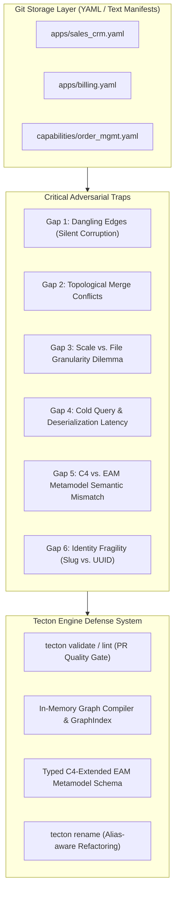

# Adversarial Analysis: Storing EAM Graphs in Git via C4-Extended DSL

This document provides a rigorous adversarial analysis (*gap and failure-mode analysis*) of utilizing **Git as a Single Source of Truth** for an **Enterprise Architecture Management (EAM) Graph Repository**, structured as a **C4-Extended Architecture-as-Code DSL**.

---

## 1. The Core Conceptual Tension

```
┌────────────────────────────────────────────────────────────────────────┐
│                   THE ARCHITECTURAL MISMATCH PARADOX                   │
├──────────────────────────────────┬─────────────────────────────────────┤
│ How Git Works (Text & Tree):     │ How EAM Graphs Work (Topology):     │
│ • Hierarchical directory tree    │ • Cross-cutting relational graph    │
│ • Line-by-line textual diffs     │ • Deep, non-linear edge pointers    │
│ • Content-addressed blobs        │ • Referential foreign-key integrity │
│ • Textual branch auto-merges     │ • Topologically invariant DAGs/paths│
└──────────────────────────────────┴─────────────────────────────────────┘
```

Git was engineered for hierarchical source code files and sequential textual changes. An EAM repository, conversely, is a **Directed Labeled Property Graph (DLPG)** where nodes (*Capabilities, Systems, Technologies, Data Objects*) are bound together through multidimensional, cross-domain dependencies.

Treating Git as an EAM graph database yields major advantages (clean PRs, code reviews, version history, zero vendor lock-in), but introduces **six critical failure modes** that do not exist in conventional graph databases.

---

## 2. The Six Fatal Adversarial Gaps of Git-Backed EAM Graphs



---

### Gap 1: Referential Integrity Breakdown & Dangling Edges
*   **The Trap:** In an enterprise graph database (e.g., Neo4j, LeanIX), node deletion cascades or triggers foreign-key constraint violations. In Git, if Developer A deletes `apps/regional_tracker.yaml` in PR #101, Git happily approves the deletion. However, `capabilities/lead_tracking.yaml` and `apps/global_crm.yaml` still reference `regional_tracker` as a supported system or integration target.
*   **Git Behavior:** Git merge reports `Merge made by recursive strategy. 0 conflicts`.
*   **Consequence:** **Silent graph corruption merged into `main`**. The graph now contains broken pointers (*dangling edges*) that crash downstream export scripts and pipeline evaluators.
*   **Tecton Defense:** **Pre-merge Referential Integrity Gate (`tecton validate`)**. The linter constructs an internal symbol table of all declared entity identifiers and enforces that every edge target resolves to a valid declared node. A dangling pointer returns exit code `1`, blocking PR merge.

---

### Gap 2: Topological Merge Conflicts vs. Clean Text Merges
*   **The Trap:** Git performs textual line-based merging. It does not understand graph theory, cycle detection, or architectural invariants.
*   **Scenario A (Illegal Cycle Introduction):**
    *   *Branch 1:* Developer adds dependency: System A $\to$ System B.
    *   *Branch 2:* Developer adds dependency: System B $\to$ System A.
    *   *Result:* Git merges both branches without a single conflict. The architecture now contains a circular dependency that breaks layered architecture rules and recursive roll-up engines.
*   **Scenario B (Exclusive Realization Collision):**
    *   *Branch 1:* Marks System A as the exclusive `Leading System` for Capability C.
    *   *Branch 2:* Marks System B as the exclusive `Leading System` for Capability C.
    *   *Result:* Git merges cleanly, leaving Capability C in an illegal multi-master state.
*   **Tecton Defense:** **Semantic Graph Linter**. Tecton validates directed acyclic graph (DAG) invariants, cycle detection (Tarjan / Kosaraju algorithms), and single-leader cardinality rules before PR approval.

---

### Gap 3: The Scale vs. File-Granularity Tension
*   **The Dilemma:**
    *   *Approach A (Monolithic DSL File, e.g., `landscape.c4.yaml`):* Single file makes cross-references trivial to write, but creates constant merge conflicts whenever two engineers touch the architecture concurrently.
    *   *Approach B (Ultra-Fine-Grained, 1 file per entity):* Avoids merge conflicts, but creates thousands of tiny files. A simple change (renaming an interface) produces a PR spanning 40 files, making peer review tedious and I/O traversal slow.
*   **Tecton Defense:** **Domain-Bounded Multi-Document DSL Layout**. Tecton supports fine-grained directories (`systems/`, `capabilities/`, `technologies/`) as well as domain bundles (`domains/sales.yaml`), resolved transparently through an agnostic ingestion loader.

---

### Gap 4: Cold Query Latency & Missing Graph Indexes
*   **The Trap:** Git provides no indexing mechanism. To execute an analytical query such as *"Find all applications with Technical Fit < 3.0 that depend on an EOL database"*, the system cannot query a B-Tree index.
*   **Performance Penalty:** Tecton must:
    1. Read and parse 500–2,000 YAML files from disk.
    2. Validate Pydantic v2 schemas across all entities.
    3. Construct adjacency maps in RAM.
    4. Only then execute graph traversal.
*   **Tecton Defense:** **Compiled In-Memory Graph Index (`GraphIndex`)**. In-memory caching, vectorized set operations, and optional local binary snapshots (`.tecton/cache.bin`) for high-speed local interactive querying.

---

### Gap 5: C4 vs. EAM Metamodel Semantic Mismatch
*   **The Trap:** The C4 model (Simon Brown) was created for software architecture (Context, Containers, Components, Code). It excels at describing *runtime execution* (System X calls System Y over HTTPS). However, Enterprise Architecture requires **business, financial, and strategic governance**:
    *   *Business Capabilities* (hierarchical L1/L2/L3 functional decomposition).
    *   *Portfolio Evaluation* (Gartner TIME framework: Tolerate, Invest, Migrate, Eliminate).
    *   *Technology Risk* (Vendor lifecycles, EOL/EOS dates).
    *   *Information Governance* (Data objects, GDPR confidentiality tiers).
*   **Risk:** Trying to force EAM data into vanilla C4 Structurizr DSL results in an unmaintainable abuse of unstructured tags (`tags: ["TIME:INVEST", "EOL:2027", "BC:OrderMgmt"]`), destroying static type safety and validation.
*   **Tecton Defense:** **C4-Extended EAM Schema**. First-class typed primitives for both structural execution (Systems, Containers) and enterprise strategy (Capabilities, Lifecycles, TIME scores, Tech Stacks).

---

### Gap 6: Identity & Identifier Fragility (Slug vs. UUID)
*   **The Dilemma:**
    *   *Using UUIDs (`id: "c4a8f1e2-9b2a-..."`):* Safe against renames, but completely unreadable in Git PR diffs. A diff showing `source: c4a8f1e2 target: b19d88aa` defeats the entire human-centric purpose of Architecture-as-Code.
    *   *Using Slugs/Names (`id: "global-sales-crm"`):* Beautiful and intuitive in PR diffs, but highly fragile: renaming a system breaks foreign references across all capability mappings and relationship files.
*   **Tecton Defense:** **Human-Readable Kebab-Case Slugs with an Automated Refactoring Engine**. Tecton enforces predictable slugs (`crm-global`, `ledger-core`) and provides a dedicated CLI command (`tecton refactor rename <old-id> <new-id>`) that automatically updates all inbound references across the Git repository atomically.

---

## 3. Comparative Matrix: Git-Backed EAM vs. Graph Database

| Feature / Challenge | Native Graph Database (Neo4j / SaaS EAM) | Raw Git Repository (Markdown/YAML) | Tecton Git-Backed C4 DSL |
| :--- | :--- | :--- | :--- |
| **Version History & Audit** | Basic change log in database | Cryptographic, immutable Git history | Cryptographic Git history + living docs |
| **Review Workflow** | Ad-hoc approvals in UI | Standard Git Pull Requests | PR Code Review + `tecton validate` gate |
| **Referential Integrity** | Enforced by DB engine | **Broken (Dangling edges)** | Enforced by `tecton validate` CI linter |
| **Cycle & Constraint Checks**| Schema constraint triggers | **Ignored (Silent graph bugs)**| Enforced by topological cycle detector |
| **Merge Resolution** | Last-write-wins or locking | Textual Git merge | Textual merge + pre-merge graph gate |
| **EAM Domain Support** | Proprietary closed metamodel | Zero native support | Typed C4-Extended EAM Metamodel |
| **Vendor Independence** | High lock-in | 100% Sovereign text files | 100% Sovereign open YAML/JSON DSL |

---

## 4. Architectural Prescription for Tecton

To deliver an industrial-grade Git-backed EAM graph repository without succumbing to the 6 adversarial failure modes, Tecton implements the following design:

1. **C4-Extended EAM Schema:** Declarative YAML files containing typed blocks:
   * `capabilities:` (Hierarchical business capabilities L1–L3)
   * `systems:` (Software systems with Gartner TIME metrics, lifecycles, and tech stacks)
   * `containers:` (Microservices, databases, serverless functions)
   * `relationships:` (Explicit source $\to$ target contracts with protocols and descriptions)
2. **Quality Gate CLI (`tecton validate` / `tecton lint`):**
   * Verifies 100% referential integrity (no dangling IDs).
   * Verifies topological validity (no illegal cycles, single leading systems).
   * Verifies chronological lifecycle progression.
   * Runs in under 500 ms in GitHub Actions / GitLab CI.
3. **In-Memory Graph Compiler (`GraphIndex`):**
   * Ingests the Git directory tree into an in-memory directed graph with fast adjacency traversal and index lookups.
