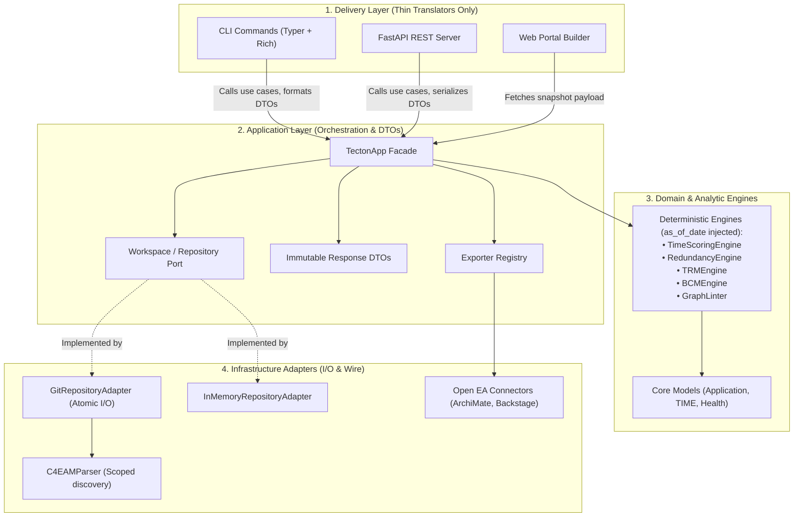

# Adversarial Analysis: Architectural Layering, State Consistency, and Operational Invariants

> **Context:** Architectural review and critical gap analysis of Tecton  following the initial Hexagonal Architecture refactoring (ADR 0001, ADR 0002, ADR 0003).
> **Assessment Date:** 2026-10-11
> **Review Scope:** Modular monolith boundaries, application facade decoupling, mutation atomicity, evaluation determinism, and air-gapped portal self-containment.

---

## 1. Executive Summary & Architectural Assessment

Tecton is architected as an **in-memory, deterministic modular monolith in Python**. Declarative architecture manifests (YAML/JSON) are parsed into a directed property graph in memory, analytical engines evaluate domain heuristics (Gartner TIME, Jaccard redundancy, lifecycle chronology, cascading technology risk), and delivery adapters (CLI, FastAPI REST server, Web Portal) expose analytical artifacts.

### Key Strengths:
1. **Appropriate Macro-Architecture:** A modular monolith with in-memory execution is the optimal architectural pattern for an offline-first Architecture-as-Code toolchain. Distributing this into microservices would introduce serialization latency, distributed transaction complexity, and network brittleness without operational benefit.
2. **Domain Model Integrity:** Pure Pydantic domain models in `tecton.core.models` and `tecton.dsl.schema` ensure strict type validation and explicit validation rules.
3. **Graph Topology Indexing:** `CompiledGraph` maintains pre-computed lookup indexes (`_incoming_index`, `_outgoing_index`, `symbol_origins`) enabling $O(1)$ relationship traversal.
4. **Isolated Analytical Engines:** Pure calculation algorithms (`TimeScoringEngine`, `RedundancyDetectionEngine`, `LifecycleValidator`, `BCMEngine`, `TRMEngine`, `LineageEngine`) are decoupled from external protocols.

### Core Critical Finding:
**The fundamental architecture is sound, but the hexagonal refactoring remains unfinished and currently blocks application startup (broken import chain). Furthermore, architectural boundaries are unenforced in CI, mutations suffer from split-brain risks, evaluations drift temporally due to hardcoded system clocks, and the "offline" portal relies on external CDNs.**

---

## 2. Adversarial Gap & Threat Matrix

```
┌────────────────────────────────────────────────────────────────────────────────────────┐
│                        ARCHITECTURAL FAILURE MODES IN TECTON                          │
├──────────┬─────────────────────────────────────┬───────────────────────────────────────┤
│ Severity │ Failure Mode / Structural Trap      │ Cascading Impact                      │
├──────────┼─────────────────────────────────────┼───────────────────────────────────────┤
│ **P0**   │ Broken Import Chain via Deleted DSL │ Total delivery gridlock: CLI, Server, │
│          │ Linter Module                       │ and Portal crash on import (11 tests) │
├──────────┼─────────────────────────────────────┼───────────────────────────────────────┤
│ **P1**   │ Delivery Bypass of Application      │ Dual maintenance, divergent logic,   │
│          │ Layer (`TectonApp` Facade)          │ scattered serialization boilerplate   │
├──────────┼─────────────────────────────────────┼───────────────────────────────────────┤
│ **P1**   │ Toothless Architecture Fitness Test │ False sense of safety: 9 violations   │
│          │ (`assert isinstance(..., list)`)    │ ignored, relative imports unchecked   │
├──────────┼─────────────────────────────────────┼───────────────────────────────────────┤
│ **P1**   │ Split-Brain Mutation & Non-Atomic   │ Dirty in-memory state on I/O error,   │
│          │ Persistence (`GitAdapter.apply`)    │ graph desynchronized from storage     │
├──────────┼─────────────────────────────────────┼───────────────────────────────────────┤
│ **P2**   │ Temporal Drift via `date.today()`    │ Non-reproducible CI results, time-    │
│          │ in Deterministic Engines            │ bomb quality gate breaks on PRs       │
├──────────┼─────────────────────────────────────┼───────────────────────────────────────┤
│ **P2**   │ The "Offline" Illusion: CDN Scripts │ Silent rendering failure in air-gapped│
│          │ in Exported Living Portal           │ or restricted enterprise enclaves     │
├──────────┼─────────────────────────────────────┼───────────────────────────────────────┤
│ Struct.  │ Concrete Coupling of `Workspace` to │ Domain bound to local Git filesystem, │
│          │ `GitRepositoryAdapter` & Parser     │ impossible to swap in-memory/S3 source│
├──────────┼─────────────────────────────────────┼───────────────────────────────────────┤
│ Struct.  │ Greedy Manifest Ingestion & Lax     │ Phantom applications ingested from    │
│          │ Heuristic Matching (`rglob("*")`)   │ docker-compose, CI configs, fixtures  │
└──────────┴─────────────────────────────────────┴───────────────────────────────────────┘
```

---

## 3. Deep-Dive Adversarial Breakdown

### Gap 1 (P0): Broken Import Chain & Delivery Gridlock
* **The Reality vs Fiction:** `src/tecton/dsl/linter.py` was moved to `src/tecton/engines/linter.py` to preserve clean layering, but callers in delivery modules (`server/app.py`, `portal/builder.py`) were left pointing to `tecton.dsl.linter`.
* **The Failure Mode:** When any CLI command is invoked (`tecton --help`, `tecton validate`), `tecton.cli.main` imports `export_cli`, which imports `portal.builder`, crashing the entire interpreter with `ModuleNotFoundError: No module named 'tecton.dsl.linter'`.
* **Remediation:** 
  1. Route all validation and snapshot queries through `TectonApp` in `src/tecton/application/app.py`.
  2. Eliminate direct engine/linter imports in delivery layers.
  3. Ensure all tests import `GraphLinter` from `tecton.engines.linter`.

---

### Gap 2 (P1): Application Layer Bypass & Logic Duplication
* **The Reality vs Fiction:** ADR 0001 stipulates that Delivery Channels (`cli`, `server`, `portal`) must be thin translators delegating orchestration to `tecton.application`. While `TectonApp` was created, `server/app.py` and CLI commands (`export_cli.py`, `bcm_cli.py`, `trm_cli.py`, `diff_cli.py`) still instantiate domain engines directly, manually format JSON structures, and replicate aggregation algorithms.
* **The Failure Mode:** 
  * A change to APM or TRM reporting calculations requires updating CLI Rich formatting, FastAPI REST response serializers, and Portal JSON payloads independently.
  * Inconsistencies arise between what `tecton apm analyze` reports in the terminal versus what `/api/v1/apm/analysis` returns over HTTP.
* **Remediation:**
  * Complete `TectonApp` as the single unified facade exposing typed DTOs (`HealthDto`, `OverviewDto`, `ValidationReportDto`, `ApmAnalysisDto`, `BcmAnalysisDto`, `TrmAnalysisDto`, `RoadmapAnalysisDto`).
  * Enforce that CLI and FastAPI handlers only perform argument parsing, call a `TectonApp` method, and format the returned DTO.

---

### Gap 3 (P1): Toothless Architecture Fitness Test
* **The Reality vs Fiction:** `tests/unit/test_architecture.py` scans source code AST to enforce Hexagonal boundary rules. However, line 85 asserts only:
  ```python
  assert isinstance(violations, list)
  ```
* **The Failure Mode:** Developers or automated refactoring scripts can introduce arbitrary illegal cross-layer couplings (e.g., DSL importing engines, CLI importing connectors directly), and CI will happily report `1 passed`. The test is purely observational ("characterization") and provides zero architectural enforcement. Furthermore, AST checking does not currently catch relative imports (`from ..connectors import X`).
* **Remediation:**
  1. Fix the remaining 9 violations.
  2. Change the assertion to strict enforcement:
     ```python
     assert len(violations) == 0, f"Architectural violations detected: {violations}"
     ```
  3. Resolve relative imports to absolute module paths before evaluating boundary rules.

---

### Gap 4 (P1): Split-Brain Mutation & Dirty State Desynchronization
* **The Reality vs Fiction:** ADR 0003 mandates a "Safety-First Mutation Policy". In `src/tecton/adapters/git_adapter.py`:
  ```python
  def apply_patches(self, entity_id: str, patches: list[dict], dry_run: bool = True):
      result = super().apply_patches(entity_id, patches, dry_run=dry_run)  # Mutates self._storage FIRST!
      if not dry_run:
          origin_file = self.graph.symbol_origins.get(entity_id)
          if origin_file:
              self._persist_entity_patch(entity_id, patches, Path(origin_file)) # Disk write SECOND!
      return result
  ```
* **The Failure Mode:**
  1. `super().apply_patches()` mutates the in-memory `_storage` dictionary.
  2. `_persist_entity_patch` attempts to serialize and write YAML to disk. If disk write fails (out of disk space, write permission denied, OS crash, invalid YAML formatting), the in-memory state remains modified while the disk remains unmodified.
  3. Furthermore, `self.graph` is NOT recompiled! `self._storage` holds the new entity, `self.graph` holds the old entity, and disk holds who-knows-what. Any subsequent query in the same process serves dirty, desynchronized data.
* **Remediation:**
  * **Transactional Order:** 
    1. Validate patch against in-memory entity copy.
    2. Atomic write to disk using temp file + atomic rename (`tempfile.NamedTemporaryFile` + `os.replace`).
    3. On successful atomic write, trigger graph recompilation / reload and update `self._storage`.
    4. If disk write fails, in-memory state is completely untouched.

---

### Gap 5 (P2): Temporal Drift via Hardcoded `date.today()`
* **The Reality vs Fiction:** ADR 0002 pledges "Deterministic In-Memory Analytic Engines" that produce mathematically reproducible evaluations. In reality, `date.today()` is called directly inside:
  * `core/models.py` (application lifecycle phase evaluation)
  * `engines/trm_engine.py` (technology obsolescence / EOL checks)
  * `engines/linter.py` (obsolescence governance rules)
  * `engines/roadmap_engine.py` (plateau and work package timelines)
  * `exporters/mermaid.py` (Gantt chart generation)
* **The Failure Mode:**
  * An identical repository evaluated on October 31 versus November 1 produces different validation reports and exit codes because a technology reached its EOL date overnight.
  * CI pipelines fail on PRs modifying unrelated Markdown documentation simply because a calendar milestone elapsed.
  * Historical Git diff audits (`tecton diff commitA commitB`) evaluate both past commits against *current real-world today*, invalidating historical back-testing.
* **Remediation:**
  * Introduce an explicit parameter `as_of_date: date | None = None` across all engines, linter rules, and `TectonApp` facade methods (defaulting to current date if omitted, but strictly overridable).
  * Record `evaluated_as_of: YYYY-MM-DD` in all JSON/DTO reports.
  * In `tecton diff`, allow comparing states as of their respective Git commit timestamps.

---

### Gap 6 (P2): The "Offline" Illusion: CDN Dependencies in Web Portal
* **The Reality vs Fiction:** The CLI documentation describes `tecton export portal` as generating a `"100% offline self-contained HTML bundle"`. In `src/tecton/portal/template.py`:
  ```html
  <!-- Tailwind CSS CDN -->
  <script src="https://cdn.tailwindcss.com"></script>
  <!-- Mermaid.js CDN -->
  <script src="https://cdn.jsdelivr.net/npm/mermaid@10/dist/mermaid.min.js"></script>
  ```
* **The Failure Mode:**
  * When opening `dist/index.html` inside a high-security air-gapped corporate network, bank environment, or offline development machine, external CDN requests are blocked.
  * Tailwind styles fail to load, leaving unstyled raw text.
  * Mermaid.js is absent, causing JavaScript errors and blank diagram containers. The portal is completely inoperable offline.
* **Remediation:**
  * In `export portal`, bundle local or embedded vendor assets (inlined minified CSS / JS or packaged static directory `dist/assets/`).
  * Provide fallback offline rendering or asset bundling so no network requests are issued.

---

### Gap 7 (Structural): Concrete Coupling of Workspace & Graph Contract
* **The Reality vs Fiction:** ADR 0001 specifies Hexagonal Ports & Adapters. However:
  * `Workspace` in `tecton.application.workspace` hard-codes `self._adapter = GitRepositoryAdapter(self.path)`.
  * Analytic engines and services accept `CompiledGraph`, a concrete dataclass defined in `tecton.dsl.parser`.
* **The Failure Mode:**
  * Impossible to test application use cases with an in-memory repository without pointing to a real directory path on disk.
  * The Domain and Application layers depend directly on DSL parsing details rather than an abstract architecture graph protocol.
* **Remediation:**
  * Define `ArchitectureGraphProtocol` in `tecton.core` or `tecton.application`.
  * Allow `Workspace` to accept any `ArchitectureRepositoryPort` implementation (dependency injection).

---

### Gap 8 (Structural): Greedy Ingestion & Unbounded File Matching
* **The Reality vs Fiction:** `C4EAMParser.parse_directory` scans recursively via:
  ```python
  manifest_files = [p for p in path.rglob("*") if p.suffix.lower() in (".yaml", ".yml", ".json")]
  ```
  And when encountering an unclassified dictionary:
  ```python
  elif "id" in item and "name" in item:
      table.register_system(SoftwareSystemDef.model_validate(item), origin)
  ```
* **The Failure Mode:**
  * If a user runs `tecton validate .` at repository root, the parser ingests `docker-compose.yml`, GitHub Actions workflows, `package.json`, `tsconfig.json`, or mock fixtures.
  * Any object possessing `id` and `name` is registered as a production `SoftwareSystem`.
  * The architectural inventory is polluted with phantom applications, triggering cascading dangling pointer errors and false alarms.
* **Remediation:**
  * Restrict manifest discovery:
    1. Support explicit configuration in `tecton.yaml` (e.g. `manifests: ["architecture/**/*.yaml"]`).
    2. Require an explicit `kind:` or `tecton:` schema discriminator before falling back to heuristic parsing.
    3. Ignore standard non-architecture paths (`.github/`, `node_modules/`, `dist/`, `build/`, `fixtures/`).

---

## 4. Target Architecture & Hexagonal Boundaries



---

## 5. Strict Execution Order & Implementation Roadmap

| Step | Phase | Action Items | Success Criteria |
|---|---|---|---|
| **1** | **P0: Fix Startup** | • Update `server/app.py` and `portal/builder.py` to use `TectonApp` or `engines.linter`.<br>• Fix collection errors in test suite. | `pytest` collection completes with 0 errors across all 11 failing test modules. |
| **2** | **P1: Application Facade** | • Route `export_cli.py` and `import_cli.py` through `TectonApp`.<br>• Route `server/app.py` export and validation endpoints through `TectonApp`. | 0 direct imports of `connectors`, `engines`, or `dsl.parser` in delivery layer. |
| **3** | **P1: Enforce Arch Gate** | • Enhance `tests/unit/test_architecture.py` to detect relative imports.<br>• Assert `assert len(violations) == 0`. | Architectural fitness test passes with 0 violations enforced in CI. |
| **4** | **P1: Atomic Persistence** | • Refactor `GitRepositoryAdapter.apply_patches` to write atomically via temp file.<br>• Recompile/reload graph before mutating in-memory cache. | Simulated disk write failure leaves in-memory and disk state 100% consistent. |
| **5** | **P2: Temporal Determinism**| • Add `as_of_date: date | None = None` to all engines and `TectonApp`.<br>• Eliminate bare `date.today()` calls. | Tests running with mocked/past dates produce mathematically reproducible outputs. |
| **6** | **P2: Truly Offline Portal**| • Package standalone vendor bundle (Tailwind CSS + Mermaid JS) for offline export.<br>• Eliminate CDN hard-dependencies in offline export mode. | Exported HTML renders complete styled diagrams in browser with network disabled. |
| **7** | **Structural Hardening**| • Introduce manifest path scoping and ignore rules in `C4EAMParser`.<br>• Disallow ambiguous `{"id", "name"}` heuristic matching on non-manifest files. | Arbitrary JSON/YAML in repo does not pollute architecture graph. |
