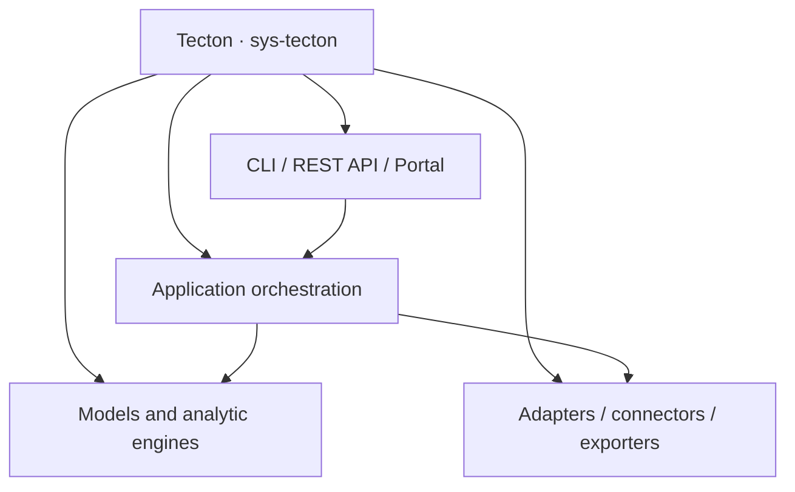

# 🏛️ Tecton's own architecture

The current source of truth is
[`examples/dogfood/tecton_c4_workspace`](../examples/dogfood/tecton_c4_workspace).
It models **one software product**, `sys-tecton`, and **15 logical child
components** using the existing `containers` schema. Stable module IDs are
retained; they no longer represent separate portfolio applications.

## Model overview

- Product owner: `Tecton maintainers`, an initial team label for pilot review.
- Lifecycle: explicitly `active`; no speculative end-of-life date.
- Ten capabilities cover CLI, validation, reporting, analytics and adapters.
- Components cover CLI, application orchestration, models, validation, analytical
  engines, adapters, connectors, API, portal and visual exporters.
- The runtime catalog describes Python 3.11+, matching package requirements.
  The older `tech-python-312` ID is intentionally retained as a stable reference.
- Relationships describe selected implementation dependencies, not an exhaustive
  runtime call graph or automatically discovered dependency inventory.



## Reproduce the review

```bash
tecton validate examples/dogfood/tecton_c4_workspace --require-owner --format json
tecton apm analyze --source examples/dogfood/tecton_c4_workspace
tecton export portal --source examples/dogfood/tecton_c4_workspace -o dist/portal
```

The product's suitability scores and TIME label are illustrative input, not an
independent assessment of production readiness. The old
`examples/dogfood/tecton_landscape.json` remains a separate seven-entry legacy
APM fixture with a fictional retired prototype; it is not the canonical product catalog.
See the [pilot guide](08_git_eam_pilot.md) for reviewed change exercises.
