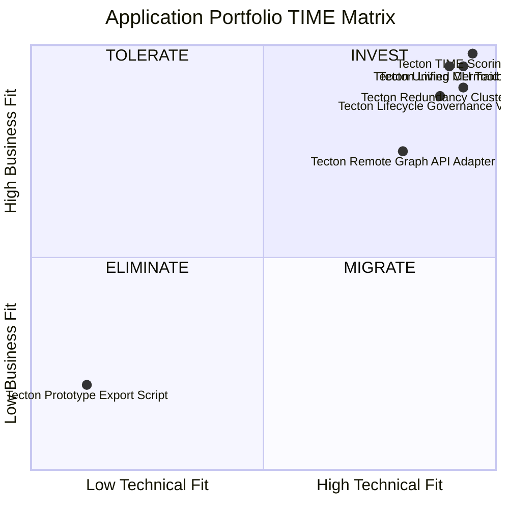

# Tecton APM Portfolio Analysis Report

> **Generated by Tecton Engine** | Deterministic Architecture-as-Code Governance

## 1. Portfolio Executive Summary

- **Total Applications Audited:** 7
- **Classified Applications:** 7
- **Unscored Applications:** 0
- **Redundancy Clusters Detected:** 0
- **Lifecycle Chronological Errors:** 0

### Rozkład Kwadrantów TIME

| Kwadrant | Liczba Aplikacji | Udział % | Rekomendacja Strategiczna |
| :--- | :--- | :--- | :--- |
| **INVEST** | 6 | 85.7% | Rozwijaj i skaluj |
| **TOLERATE** | 0 | 0.0% | Utrzymuj, planuj refaktoring techniczny |
| **MIGRATE** | 0 | 0.0% | Konsoliduj lub zmień przeznaczenie |
| **ELIMINATE** | 1 | 14.3% | Wycofaj i wygaś wsparcie |
| **UNKNOWN** | 0 | 0.0% | Uzupełnij oceny przydatności |

---

## 2. Diagram Kwadrantowy TIME (Mermaid)

---

## 3. Zidentyfikowane Redundancje Funkcjonalne

*Nie wykryto krytycznych nakładań funkcjonalnych powyżej zadanego progu.*

---

## 4. Spójność Chronologiczna Cyklu Życia

✅ *Wszystkie fazy cyklu życia systemów wykazują poprawną chronologię.*
